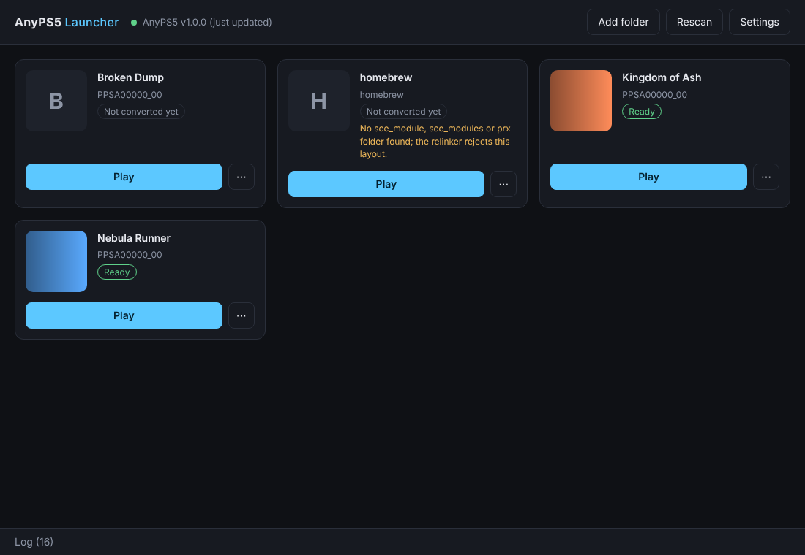
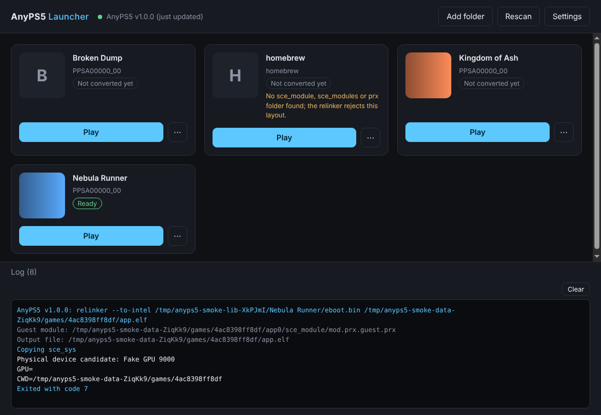
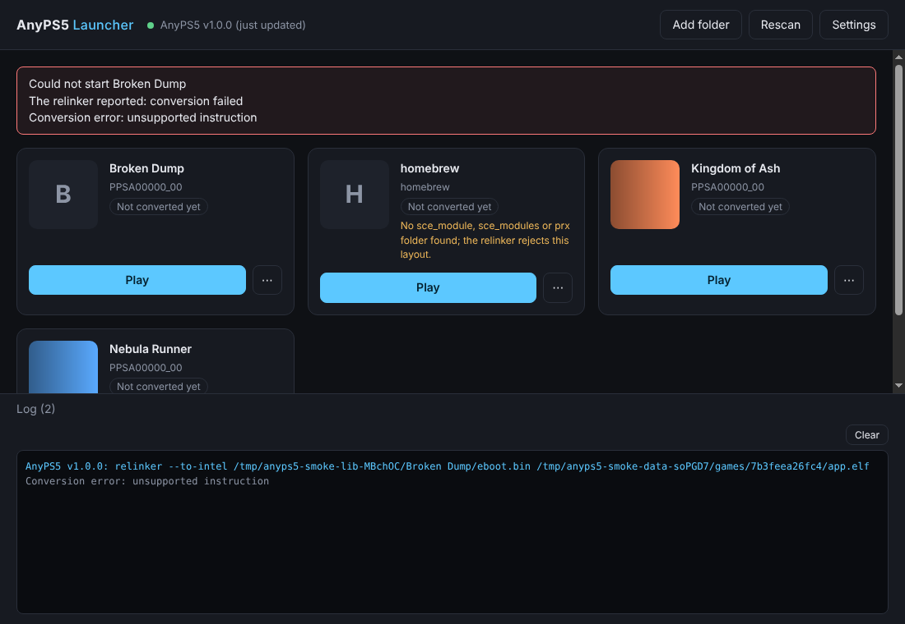
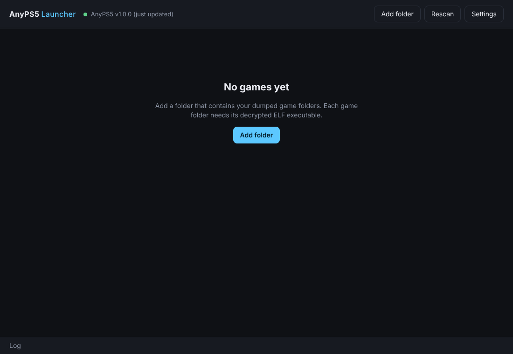
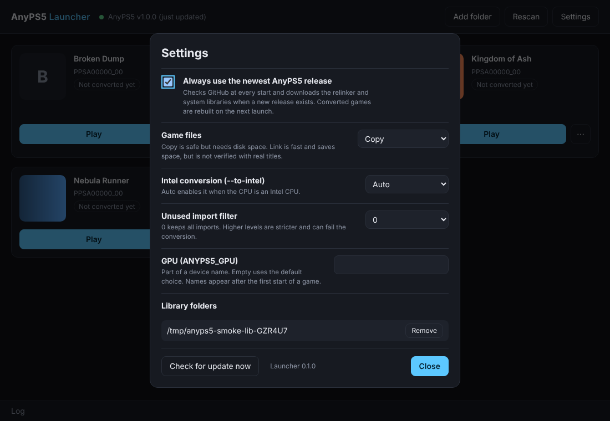
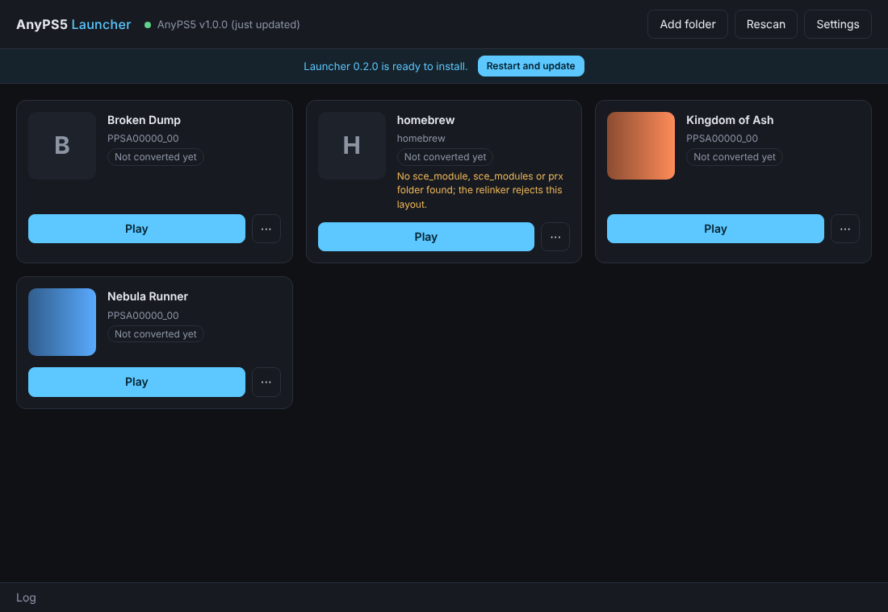

# AnyPS5 Launcher

Repository: **AnyPS5-Demo-Launcher**. English only.

A small desktop app (Electron) that gives [AnyPS5](https://github.com/boykopovar/AnyPS5) a game library: pick a game, press **Play**.

The launcher does the manual steps from the AnyPS5 [usage guide](https://github.com/boykopovar/AnyPS5/blob/main/docs/user/USAGE.md) for you:

1. **Always the newest AnyPS5.** On every start it asks GitHub for the newest published release of `boykopovar/AnyPS5` that contains the files for your OS (a newer release without them is skipped and mentioned in the log), downloads `relinker-<tag>[.exe]` and `prx-<linux|windows>-<tag>.tar.gz` when the installed build is older, verifies size and SHA-256 (when GitHub provides it) and switches over atomically. The previous build is kept; if the download fails or you are offline the installed build is used.
2. **Library.** Add folders that contain your game dumps. Every sub-folder with an ELF executable (and optionally `sce_sys/param.json` / `sce_sys/icon0.png` for title and cover) becomes a card.
3. **Convert once, then play.** On the first Play the launcher runs the relinker, copies the system libraries to `libs/`, and puts the game files into `app0/`. The result is cached per game and rebuilt automatically when the game files, the settings or the AnyPS5 release change.
4. **Start with a log.** The game runs with its output in the log panel; you can pick the GPU (`ANYPS5_GPU`), stop the game, rebuild or open the folders.

You need your own, legally obtained and decrypted game files. The launcher downloads nothing but AnyPS5 itself and does not circumvent any protection.

## Screenshots

All screenshots were taken from the real Electron app with demo data: invented game names and a local fake AnyPS5 release server. They are not real titles.

**Library.** Every folder with an ELF executable becomes a card. The top bar shows which AnyPS5 build is installed.



**Log.** The relinker output and the game output appear in the log panel while a game starts.



**Errors stay visible.** If the relinker fails, the launcher shows its message and keeps its output in the log.



**First start.** Add the folder that holds your game dumps.



**Settings.** Auto-update of AnyPS5, copy or link game files, `--to-intel`, import filter, GPU and library folders.



**Launcher updates.** The packaged app downloads new launcher versions in the background and offers a restart.



## Run

```sh
npm install
npm start
```

Data (settings, downloaded AnyPS5 builds, converted games) lives in the Electron user-data folder (`~/.config/anyps5-launcher` on Linux, `%APPDATA%\anyps5-launcher` on Windows).

## Settings

| Setting | Effect |
|---|---|
| Always use the newest AnyPS5 release | Check and update at every start (default on). Off: use the installed build, download only if none exists. |
| Game files: Copy / Link | Copy the game's resources into `app0/` (default) or link them (saves disk space, experimental). |
| Intel conversion | `--to-intel`. Auto enables it when the CPU model contains "Intel". |
| Unused import filter | `unused-filter=0\|1\|2`. |
| GPU | Value for `ANYPS5_GPU` (part of a device name). |

## What is verified and what is not

Verified by automated tests (`npm test`, 51 tests, plus a mutation check of the key ones): release asset names against AnyPS5's `release.yml` and `tools/package_release.py`; download, checksum failure, rollback, offline and API-fallback behaviour against a local fake release server; the tar reader against an archive written by Python `tarfile` like the real packager; scanning; conversion cache invalidation; relinker error reporting; the GPU environment variable; stopping a game. The relinker output layout (`app0/sce_module/<name>.guest.prx` next to the output file) was measured with a real AnyPS5 relinker build.

Not verified:

- No real PS5 title was run. Which resources a game needs in `app0/` is an assumption: everything except the executable and the module folders (`sce_module`, `sce_modules`, `prx`; the relinker writes the converted modules there itself).
- The download from the real GitHub was not run in the development sandbox (network access to GitHub was blocked there); the code path is tested against a local server with the same URL layout.
- `sce_sys/param.json` / `icon0.png` are read on a best-effort basis; without them the folder name is the title.
- Windows: the code paths exist (`--windows`, `app.exe`, junctions for linked folders), but the tests run on Linux only.
- Future AnyPS5 releases may change relinker options; the launcher passes only `--windows`, `--to-intel`, `unused-filter=N`, input and output.

## Develop

```sh
npm test                 # unit and integration tests against a fake release server
node scripts/smoke.js shot.png   # starts the real Electron app under xvfb and saves a screenshot
```

## Installers and launcher updates

- `npm run dist` builds the installer for the current OS with electron-builder: an **AppImage** on Linux and an **NSIS setup** on Windows (output in `dist/`).
- A release is created either by pushing a tag such as `v0.2.0` (it must equal the version in `package.json`) or by running the "Release" workflow manually from the Actions tab on `main` (the tag `v<package.json version>` is then created for you). `.github/workflows/release.yml` runs the tests, builds both installers, then publishes a GitHub release with the installers and the `latest*.yml` files the self-update reads.
- The packaged app updates itself with `electron-updater`: it checks the releases of this repository 5 seconds after start and every 6 hours, downloads in the background and shows a banner with **Restart and update**. It never restarts while a game is running, and an update that is already downloaded is also installed when you quit. Self-update works for the Windows installer and the AppImage; other package types and development runs skip it.
- Self-update reads the releases of this repository anonymously, so it works as long as the repository (and its releases) stay public. Without a published release the check finds nothing to update.
- The Linux AppImage was built and started in the development sandbox. The Windows installer and the whole release workflow have not been run yet; the first tag will show whether they need adjustments.

Not done yet: per-game settings, code signing (Windows shows a SmartScreen warning for unsigned installers).
